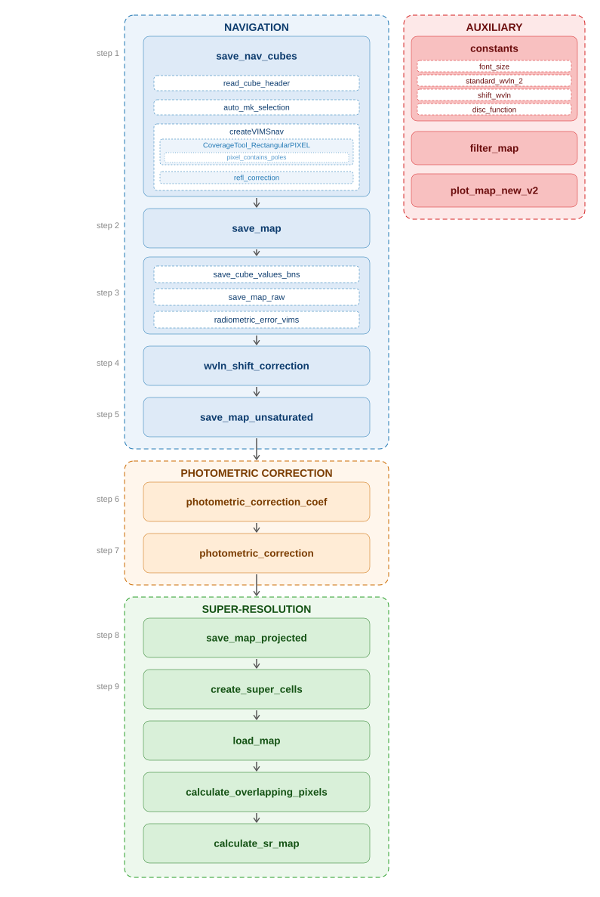

# pySRIMP: Super-Resolution for Icy Moons and Planetary bodies

## Description
The icy moons of the outer solar system have been found in the forefront of planetary exploration, due to their diverse geomorphology coupled with numerous discoveries hinting to possible habitable conditions. Of paramount importance for constraining the internal structure and properties of these bodies are high-precision cartographic products, allowing for linking surface morphologies and composition to internal activity. These cartographic products are constructed by reconciling numerous different observations, which, due to the complexities of an orbital tour, are recorded under a great range of different illumination and observation conditions, with varying spatial sampling. The aim of this study is to provide a complete pipeline for producing Super-Resolution (SR) maps for icy moons, by combining all the overlapping observations for a specific target. The development and testing of our pipeline are carried out for Enceladus, using the hyperspectral cubes recorded by the Visual and Infrared Mapping Spectrometer (VIMS) instrument, on board the Cassini Saturn orbiter. We first navigate the data, calculating accurate projections that can be combined into global mosaics of Enceladus. We then implement a global photometric correction model that compensates for the different acquisition conditions. Finally, we combine all the overlapping observations to calculate the new SR maps of Enceladus in the infrared. The new SR global map of Enceladus provides new insight into the moon’s geomorphology as revealed from its surface spectral heterogeneity at finer spatial resolution, demonstrating the capability of SR to augment our current understanding of icy moons and help prepare for future observations.

## Pipeline
In the following schematic the user can find the SR pipeline workflow as implemented in the _main.py module. The pipeline consists of three blocks corresponding to the three main steps of the methodology: Navigation, Photometric Correction and Super-Resolution. An additional block to the right, lists auxiliary modules used for constants, filtering of the data and visualisation.

## Usage
The SR pipeline has been tested on the Enceladus VIMS data set (but we strongly encourage broad implementation on varying instruments and targets). The names of the calibrated cubes used can be found in this repository in the Enceladus_cubes_ds4.txt file (Enceladus_cubes_flybys_ds4.txt contains the corresponding flyby names) and can be downloaded from the [Cassini VIMS Data Portal by Observatoire des Sciences de l'Univers Nantes Atlantique (Osuna)](https://vims.univ-nantes.fr/). The list of the SPICE kernels used can be found in the following metakernels: cas_2004_v26.tm, cas_2005_v27.tm, cas_2006_v26.tm, cas_2007_v24.tm, cas_2008_v22.tm, cas_2009_v19.tm, cas_2011_v17.tm, cas_2012_v14.tm, cas_2013_v12.tm, cas_2014_v08.tm, cas_2015_v08.tm, cas_2016_v06.tm, cas_2017_v03.tm (most updated at the time of the development) and can be downloaded from the [Navigation and Ancillary Information Facility (NAIF)](https://naif.jpl.nasa.gov/naif/).

## Contributing
We welcome any feedback or suggestions on the provided code. Please contact C. Ntinos at ntinos@ipgp.fr or christos.ntinos@community.isunet.edu.

## Authors and acknowledgment
Accompanying paper under review:

[Christos Ntinos](https://orcid.org/0000-0003-4709-3665), [Sebastien Rodriguez](https://orcid.org/0000-0003-1219-0641), [Stephane Le Mouelic](https://orcid.org/0000-0001-5260-1367), [Rozenn Robidel](https://orcid.org/0000-0002-5544-8940), [Benoit Seignovert](https://orcid.org/0000-0001-6533-275X), [Thomas Cornet](https://orcid.org/0000-0001-5971-0056), [Nicolas Altobelli](https://orcid.org/0000-0003-4244-6302), [Gabriel Tobie](https://orcid.org/0000-0002-4494-0294), and [Claire Vallat](https://orcid.org/0000-0001-6921-868X), "Super-resolution maps of icy moons: Application to the Cassini-VIMS observations of Enceladus with updated navigation and photometric correction"

## License
TBD

## Project status
Project is under development.
